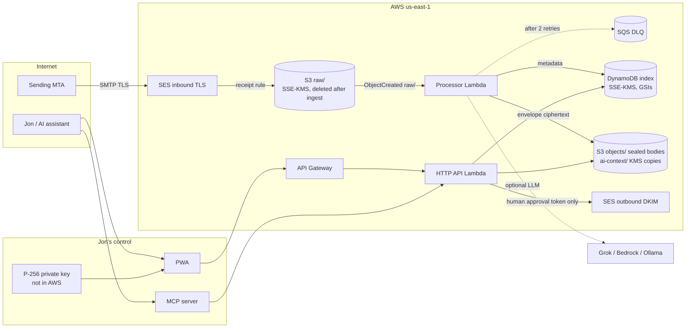

# lojo-mail architecture

lojo-mail is Jon Hebert's personal mailbox for `lojo@cyberphysical.us`. The domain is a config value (`domain` + `local_part`), so the same system can later be pointed at `lojo.dev` or another domain by creating a new SES identity and DNS plan. Nothing here is multi-tenant.

AWS is the only cloud in the mail path. Google Cloud (project `montano-349204`, Cloud Run) is intentionally unused: one account, one bill, and no always-on server. GCE is a poor fit anyway because it blocks outbound port 25, and Amazon WorkMail is discontinued.

## Why Terraform

Infrastructure is Terraform (AWS provider 5.x), not CDK.

- `terraform plan` is a readable diff Jon can review before anything is created. CDK would hide that behind a synthesized template and a bootstrap stack (ECR, IAM roles, an S3 bucket) that costs money and is easy to forget.
- DNS is data. The plan emits the exact Route 53 records and refuses to write them unless a cutover confirmation string is set.
- This repo is standalone. CDK pays off when the rest of the account is already CDK.

`terraform validate` does not need AWS credentials. `terraform plan` does, and it is still only a plan. This repo never applies.

## Mail flow

1. The apex MX already points at `inbound-smtp.us-east-1.amazonaws.com`. Standing up lojo-mail does not change it. The region stays a Terraform variable so a later domain can use another receiving region.
2. An SES receipt rule requires TLS, scans for spam/virus, and writes the raw MIME object into S3 under `raw/`. The S3 action names no KMS key; the bucket's default SSE-KMS (customer-managed key, bucket key on) encrypts it at rest, so the processor reads it with a plain `GetObject`. An S3 notification invokes the processor for each new `raw/` object. A scheduled sweep every 15 minutes ingests anything the notification missed, and raises an alarm when it does. Once live, the rule names `lojo@<domain>` and `dmarc@<domain>` only. The first deploy runs with `receiving_stage = "test"`, which names only `lojo-test@<domain>` until the [DEPLOY.md](DEPLOY.md) checklist passes. Other SES identities in the account stay untouched.
3. An S3 event invokes the processor Lambda. The function parses MIME, reads the SES verdict headers, seals the body and each attachment to Jon's public key into `objects/`, writes metadata to DynamoDB, runs the AI pipeline, and deletes the `raw/` object. AI failure never fails receipt. Any other failure throws; S3's async invoke retries twice, then the event lands in an SQS dead-letter queue with its `raw/` key, and a CloudWatch alarm fires. `docs/RUNBOOK.md` has the redrive.
4. The HTTP API and the MCP server read that index. Bodies stay sealed until something that holds Jon's private key opens them, which in production is only the browser.
5. Outbound mail is built by the API and sent with SESv2 only with a one-time approval token that a human web session minted for that exact content, after the server checked that the content is what Jon had on screen. The MCP server has no send tool. The one exception is an auto-send mail rule Jon wrote, which the processor may send only when `auto_send_enabled` is on and every guard passes (see [Mail rules](#mail-rules)).
6. Before a new inbound message is stored, Jon's rules (if any) decide its labels, folder and read state, so it lands in its final place in one write. After it is stored, a reply rule writes a draft for approval, or, under the auto-send guards, sends.

## Components

| Piece | Where | Role |
| --- | --- | --- |
| Terraform | `infra/terraform` | SES, KMS, S3, DynamoDB, IAM, Lambda, API Gateway, DNS *plan* |
| `@lojo/core` | `packages/core` | Types, MIME, envelope crypto, store interface, AI pipeline, OpenPGP helpers |
| `@lojo/pipeline` | `packages/pipeline` | S3 Lambda handler, plus the AWS adapters (DynamoDB document store, S3 blob store, KMS key wrapper) |
| `@lojo/api` | `packages/api` | Hono HTTP API. Lambda or `npm run dev` |
| `@lojo/mcp` | `packages/mcp` | MCP tools over the HTTP API, with scopes: a stdio server, and the Streamable HTTP handler the API serves at `/mcp` |
| `@lojo/local` | `packages/local` | `lojo-local` CLI and a tool-calling adapter so a local model (Ollama, or any OpenAI-compatible server) can search, read, summarize, and draft |
| `@lojo/web` | `packages/web` | Vite + React PWA |
| `@lojo/importer` | `packages/importer` | Idempotent `.eml` / mbox / vCard / CSV import, into a local store or into AWS |
| `@lojo/bridge` | `packages/bridge` | Local IMAP4rev1 + SMTP submission bridge on 127.0.0.1 for Thunderbird. Decrypts on Jon's desktop; submissions become drafts for approval |

Local development uses an in-memory DynamoDB (`MemoryDynamo`) behind the same store class the Lambdas use, so key schemas, conditional writes, index queries, and the 400 KB item limit behave like DynamoDB. Blobs go to memory or to a directory, and the KMS wrapper is a local AES key. No AWS calls. Both Lambdas are ESM bundles on `nodejs22.x`; `npm run bundles:check` imports each built bundle.

## Storage model

DynamoDB (on-demand, SSE-KMS, point-in-time recovery, deletion protection) holds the index. Every read is a `GetItem` or a paginated `Query`; nothing scans, and nothing deletes items.

| Table | Key | Indexes |
| --- | --- | --- |
| messages | `id` (`msg_` + SHA-256 of the delivery id) | `folder` (folder, date), `thread` (threadId, date), `rfc` (rfcMessageId, date), `vectors` (vecModel, date; sparse, projects only `vec`) |
| threads | `id` | `recent` (kind, lastDate); an emptied thread drops `kind` and leaves the listing |
| drafts | `id` | `recent` (kind, updatedAt) |
| contacts | `email` | `all` (kind, email) |
| audit | `day`, `id` | none |
| budget | `day` | none; the counter is an atomic `ADD` |

S3 holds:

- `raw/{sesKey}` — original MIME written by SES. Deleted by the processor after ingest; lifecycle expires leftovers after `raw_retention_days` (7) and noncurrent versions after 1 day.
- `objects/{id}.bin` — the envelope of the body (text, HTML, and the sensitive half of the AI annotation).
- `objects/{id}/{attachmentId}.bin` — one envelope per attachment. DynamoDB keeps only the keys, so items stay small whatever the attachment size.
- `ai-context/{id}.bin` — a KMS-sealed, truncated text copy of recent inbound mail for server-side AI. Expires after `ai_context_days` (30); `0` turns it off.
- `drafts/{draftId}/{attachmentId}.bin` — a file on a draft (from the iOS app or a bot), KMS-sealed under the `draft` purpose because the server sends it. Deleted when the file is removed and when the draft is sent or discarded; the Sent copy keeps the file, sealed to Jon's key.
- `rules/current.bin` — Jon's mail rules, KMS-sealed under `{ purpose: "rules" }`. The API writes it; the processor can only open it.

The index is queryable without Jon's key. That is a deliberate usability tradeoff, not an accident. These fields are stored in the clear inside DynamoDB (still encrypted at rest by KMS):

- from, to, cc, subject, date, folder, labels, unread, bulk flag
- category, priority, phishing score
- attachment file names and sizes
- a short snippet

These fields are inside the envelope and are unreadable without Jon's private key:

- text body, HTML, attachment bytes
- AI summary, thread summary, action items, suggested reply

See [SECURITY.md](SECURITY.md) for what that does and does not protect.

## Encryption layers

1. **TLS on the wire.** Inbound receipt rule sets `tls_policy = Require`. Outbound uses an SESv2 configuration set with `tls_policy = REQUIRE`. MTA-STS and TLS-RPT records are in the DNS plan.
2. **KMS at rest.** One customer-managed key encrypts the bucket (with a bucket key, to keep request cost down) and the DynamoDB tables. SES may use it only for data keys, only from this account, and only for this receipt rule set (`aws:SourceArn`).
3. **Per-message envelope.** `P-256 ECDH + HKDF-SHA256 + AES-256-GCM`, with the message id (and attachment id) as additional authenticated data. The processor seals to Jon's public key. The private key is never written to AWS, to the repo, or to disk by the server. The web app fetches `GET /v1/messages/:id/body` and opens it in the tab.
4. **KMS data keys for server-readable data.** Drafts, the AI-context copy and the rules document are sealed with per-item KMS data keys under an encryption context (`purpose` plus the id). IAM conditions on that context decide which role can create or open each kind. See SECURITY.md, key custody.
5. **OpenPGP, optional.** WKD publishing, detection of inbound encrypted mail (stored armored, not stripped), and outbound encryption to every recipient plus Jon's own key, signed when a signing key is configured. This is the only path that is end-to-end against SES.

## AI

Every non-bulk inbound message, within the daily token budget, is sent to a chat provider behind one interface (`LlmClient`, `packages/core/src/ai`), chosen by `llm_provider`:

- `grok` — xAI, OpenAI-compatible `POST /v1/chat/completions` (default base `https://api.x.ai/v1`)
- `bedrock` — Amazon Bedrock Runtime `Converse`: Nova Micro/Lite/Pro, Claude Haiku, Llama
- `openai` — any OpenAI-compatible endpoint (OpenAI, OpenRouter, a vLLM or llama.cpp server)
- `gemini` — Gemini API with an AI Studio key; `vertex` — Vertex AI with a service account (JWT exchanged for an access token) or an express-mode key. Default model Gemini 2.5 Flash-Lite
- `ollama` — Jon's lab machine at `http://100.96.1.90:11434` (`llama3.2:1b`). Only reachable from the tailnet, so from `npm run dev`, the importer, and `packages/local`, not from the Lambdas
- `mock` — tests and offline demo

Embeddings are a separate interface (`Embedder`) and a separate choice, `embed_provider`: `bedrock` (Titan Text Embeddings V2), `ollama` (`nomic-embed-text`, with its query/document prefixes), `openai`, `gemini`/`vertex` (`gemini-embedding-001`), `mock`, or `none` (the Terraform default). Any chat provider can pair with any embedder. [INTEGRATIONS.md](INTEGRATIONS.md) has the settings and [COSTS_COMPARE.md](COSTS_COMPARE.md) the prices.

The pipeline asks for one JSON object: summary, category, priority, action items and deadlines, labels, phishing score, unsubscribe info, thread summary, and a draft reply conditioned on `config/style-guide.md`. Heuristic phishing signals are merged with the model score.

**Semantic search.** At ingest, when an embedder is configured, the processor embeds the subject plus the first 2,000 characters of the body (bulk mail included, so newsletters stay findable; OpenPGP, quarantined, and DMARC-report mail excluded). The vector is truncated to `embed_dimensions` (256), L2-normalized, quantized to int8, and stored on the message item as `vec` with a `vecModel` tag (`provider/model@dims`). The sparse `vectors` index holds only messages with a vector and projects only `vec`. A query is embedded with the same model, the index is read for that tag, and messages are ranked by brute-force cosine, top 20, trash excluded. For a personal mailbox that is a few MB read per query and no always-on search service. Changing the model changes the tag, so stale vectors are ignored until `POST /v1/vectors/backfill` re-embeds mail the server can still read. Embedding failures never fail ingest, and every embedding call counts against the budget and is audited (`ai.embed`, `ai.embed_query`).

Cost guards: daily token budget in DynamoDB, body truncation, skip mail that looks like a list (`List-Id` + `List-Unsubscribe`, or `Precedence: bulk|list|junk`). Every model call, skip, and failure is an audit event. Prompts are not stored; the audit row keeps a SHA-256 of the prompt, the token counts, and the message id.

The model cannot send. It has no tools, and a suggested reply lands as a `suggested` draft. The ingest path receives a `MailSender` only through the rules runtime, only when `LOJO_AUTO_SEND=on`, and only uses it for a human-written auto-send rule that passes every guard. Sending needs the `send` scope *and* an approval token that only a signed-in human session can mint, or Jon's own Send through the Thunderbird bridge (`client-send`, bridge token only); see SECURITY.md, human approval. Priority and labels from the model are advisory: phishing-scored mail is demoted out of triage and labels pass an allowlist.

In production the API has no envelope private key. Draft reply and summarize use the AI-context copy when it exists, or text the browser opened locally and sent as `sourceText`.

## Interfaces

- **HTTP API** under `/v1`. Two kinds of principal: API tokens with scopes `read`, `write`, `send`, `body`, `compose`, `admin`, and `trash` (the bridge token only, never implied by `admin`, refused by `/mcp`), and human sessions from `POST /v1/session/login` (passphrase). Each route declares its scope or requires a human. API Gateway throttles the stage.
- **MCP** (`@lojo/mcp`). Each tool declares the scopes it needs, and a client sees only the tools its token's scopes allow. There is no send, approve, or trash tool; agents call `submit_for_approval`, and every tool result is wrapped as untrusted content. Two transports, same tools:
  - stdio (`npm run mcp`), for Cursor and other local clients. It asks `/v1/session` which scopes its token has and uses the intersection with `LOJO_API_SCOPES` (default `read`).
  - Streamable HTTP at `POST /mcp` on the API, for remote clients such as Grok. Stateless JSON-RPC (initialize, ping, tools/list, tools/call, batches of up to 20). Bearer API or agent tokens only; web sessions and browser origins are refused. Tool calls re-enter the REST API in-process with the caller's token, so the same route checks apply.
- **Agent tokens.** One per assistant, from the SSM parameter `/lojo-mail/agent-tokens`, limited to `read`, `write`, `body`, `trash`, and `rules`. `rules` is opt-in and is not implied by `admin`. The API logs every authenticated request as an `api_request` line naming the token (`agent:<label>`).
- **Local models** (`@lojo/local`). `lojo-local` runs search, inbox, read, summarize, and draft against the API, and `ask` lets a local model pick tools itself through Ollama's or an OpenAI-compatible tool-calling API. `--local` keeps summarizing and drafting on Jon's machine. See [INTEGRATIONS.md](INTEGRATIONS.md).
- **PWA** (`@lojo/web`): passphrase sign-in, inbox, triage, thread with AI summary and attachment download, compose with draft, rewrite, and one-click approve-and-send (files attached by the iOS app or a bot are listed, can be removed, and are named in the approval), a Drafts view with the approval queue, search, labels, settings. The reader turns links into buttons when the sender passed DMARC and the sender's domain is on the trusted list (Settings); every other link asks for the destination before opening. It does not render message HTML, so remote images stay unloaded. The API URL comes from `VITE_LOJO_API_URL` at build time, with an override in Settings. Phone layout stacks the list and the reader.
- **Outbound** via SESv2 `SendEmail` (and raw MIME when OpenPGP armor must be preserved). DKIM is Easy DKIM on the domain identity. Custom MAIL FROM is `mail.<domain>`.

## Mail rules

`packages/core/src/rules/`. A rules document (JSON, `config/rules.example.json`) lists rules in order. Each has match conditions on metadata (sender, recipients, subject, `List-Id`, bulk, attachments, model category, priority and labels) and actions: label, move to inbox, archive or spam, mark read, trash, or reply.

- Jon saves his rules from a signed-in session (`PUT /v1/rules`, or `npm run rules -- push`, which signs in with the passphrase). That push keeps assistant rules. An assistant with `rules` edits its own rules in chat (`upsert_rule`, `delete_rule`, `undo_last_change`), including trash. The API seals the document to `rules/current.bin` and the undo stack to `rules/history.bin`. The processor loads only `rules/current.bin`.
- Filing actions are folded into the message before its one `PutMessage`: labels accumulate, the last move wins, trash wins over moves. Trash keeps the message and sets `trashedAt`, `trashedBy: rule:<id>` and `keepUntil`. `POST /v1/messages/:id/restore` undoes it.

## Trash purge

Every path into Trash (the web app, a rule, the bridge) is a soft delete that stamps `trashedAt`, `trashedBy` and `keepUntil` (`trashRetentionDays` in the rules document, default 30, 7 to 365). The only hard delete in the system is `packages/core/src/trash/purge.ts`, run daily by the `lojo-mail-trash-purge` Lambda (`infra/terraform/purge.tf`). It has its own role, reserved concurrency 1, and never opens mail.

- `trash_purge_mode = report` (default) audits `trash.purge_report` with counts (in Trash, due, unmarked) and deletes nothing; its role has no delete permission. `purge` deletes; `off` disables the schedule.
- A message is due only if it is still in Trash, has both `trashedAt` and `keepUntil`, `keepUntil` has passed, and it was trashed at least 7 days ago. At most 100 per run.
- The row is deleted first with a DynamoDB condition (`folder = trash` and the same `keepUntil`), so a restore that races the purge wins. Then only that message's own objects (`objects/<id>…`, `ai-context/<id>.bin`) are deleted, and the thread is refreshed.
- Every purge-mode run writes `trash.purge_run`; every deletion `trash.purged` (ids and dates only). S3 noncurrent versions (30 days) and DynamoDB PITR (35 days) remain the recovery path after a purge.
- A reply rule runs after the message is stored. By default it writes a draft with origin `rule` into the approval queue. `mode: "autoSend"` sends only when the deployment allows it (`auto_send_enabled`), the kill switch is off, the rule was written by a human, and the guards in SECURITY.md pass: sender allowlist, DMARC pass, loop headers, text constraints, rate limits. Otherwise it is the same draft.
- Header-derived loop signals (`Auto-Submitted`, `Precedence`, `List-Id`, null `Return-Path`, and so on) are stored on the message as codes (`replyBlockers`), so `POST /v1/rules/test` gives the same answer later without the headers.
- A failing rule never fails delivery: load errors and reply errors are audited and the message is stored as if there were no rules. Every rule action is an audit event.

## Thunderbird and other IMAP clients

`packages/bridge` runs on Jon's desktop (Santa Computa) as a systemd user service. It speaks IMAP4rev1 (with IDLE, MOVE, SPECIAL-USE, and UIDs that stay stable across restarts; UIDPLUS is not advertised) and SMTP submission on `127.0.0.1` only, and HTTPS to the API with the bridge token. See [THUNDERBIRD.md](THUNDERBIRD.md).

- Folders map one to one: INBOX, Archive, Sent, Drafts, Junk (`spam`), Trash.
- Messages are listed with `GET /v1/folders/:folder/messages`, and each body envelope is fetched and opened on the desktop with the envelope private key. The bridge rebuilds a MIME message from the metadata, the decrypted text and HTML, and the decrypted attachments. Plaintext stays in memory; only UIDs and sizes are written to disk.
- Flags and labels sync back: `\Seen` to `POST /v1/messages/:id/flags`, `\Flagged` and keywords to labels, moves to `move` or `archive`. Delete moves to Trash when the bridge token has the `trash` scope (`bridge_trash_enabled`, on by default) and `bridge.json` keeps `deleteToTrash`: a soft delete with `trashedBy: bridge` and `keepUntil`, audited as `message.trashed`. Without the scope, or when deleting inside Trash, it archives with a hidden `thunderbird-deleted` label.
- SMTP submissions go to `POST /v1/client/send` when the bridge token holds `client-send` (`bridge_send_enabled`, on by default): the API checks the global send kill switch, the From list, size and rate limits, sends the raw MIME with SES `SendEmail` (Raw content, so Bcc and attachments go out as Thunderbird built them), matches and closes a bot draft if this was one, and seals a Sent copy. Without the scope, submissions become client drafts in the web approval queue.
- Drafts: the Drafts mailbox lists open drafts from `GET /v1/drafts` as synthetic messages (a new UID per draft version, keyword `bot-draft` for agent, AI, and rule drafts, keyword `server-files` for drafts carrying files attached through the API, which Thunderbird can't show). APPEND to Drafts creates a client draft; delete discards it.
- New mail: during IDLE the bridge checks the newest 25 messages every `newMailSeconds` (15) and does a full resync every `pollSeconds` (60).

JMAP (RFC 8620 / 8621) remains a possible later facade; the store is already shaped like it.

## What the September 2026 audit already found

A read-only look at the account, not an apply:

- SES for `cyberphysical.us` is verified in **us-east-1**, along with identities `cyberdevsec.com` and `jon@lojo.engineering`. This stack adopts `var.domain` and does not edit the other two.
- Easy DKIM is already published (six CNAMEs). Custom MAIL FROM is `mail.cyberphysical.us` (MX `feedback-smtp.us-east-1.amazonses.com` plus an SPF TXT). Apex SPF is `v=spf1 include:amazonses.com ~all`. DMARC is `v=DMARC1;p=quarantine;pct=100;fo=1` with no `rua`.
- The apex MX is already the us-east-1 inbound endpoint, TTL 1800. No receipt rule set is active in any region, so the new rule set is what starts delivery into the bucket.
- Leave these records alone: ACM validation CNAME, the six DKIM CNAMEs, `_amazonses`, the `mail.` MX and TXT, NS, and SOA. Do not add a second SPF TXT.
- `autodiscover` and `_amazonchime` look like WorkMail leftovers. They are optional cleanup after Jon confirms WorkMail is gone.
- Registrar is Gandi, managed through Route 53 Domains. DNSSEC is off. Enabling it is optional and needs a KMS signing key the current deploy user cannot create.
- IAM user `grok-rw` can use Route 53, Route 53 Domains, and SES. It cannot create KMS, S3, Lambda, DynamoDB, IAM, API Gateway, or SSM. That was the September audit; for the 4f5280c rollout Jon attached the apply rights to `grok-rw` as two managed policies, `GrokLojoMailDeployAndBilling` and `GrokLojoMailWebHosting` (see RUNBOOK.md, Who can apply). Terraform does not attach them.

`ses_identity_mode = existing` (the default) reads that identity and creates the receipt rule set, the bucket, the key, and the functions. `terraform output dns_plan` lists suggested additions and does not create them: a `rua` on the existing DMARC record (to `dmarc@<domain>`, not a second TXT), TLS-RPT, MTA-STS once the policy host exists, OpenPGP WKD hosting, and a lower MX TTL only before a future region move. `manage_dns = true` is refused in existing mode so a plan cannot overwrite those records.

## Domain switch

`domain` and `local_part` are variables. Moving from `cyberphysical.us` to `lojo.dev` means `ses_identity_mode = create` for that new name, a second DNS plan, and a decision about what happens to the old MX (leave it accepting into the same bucket, or drop it). The processor keys off the recipient only to file the message; it does not hard-code the domain in storage.

## What is intentionally not here

- No always-on EC2, ECS, or Cloud Run service.
- No OpenSearch, vector database, or other search cluster. Semantic search is brute-force cosine over a DynamoDB index.
- No WorkMail, no Google Workspace, no outbound port 25.
- No CloudFront distribution by default. The PWA is a static build Jon can host on an existing HTTPS origin or open locally. Serving the unlock UI over plain HTTP in production would expose the private key.
- No live DNS changes, no terraform apply, no purchased certificates or domains.
