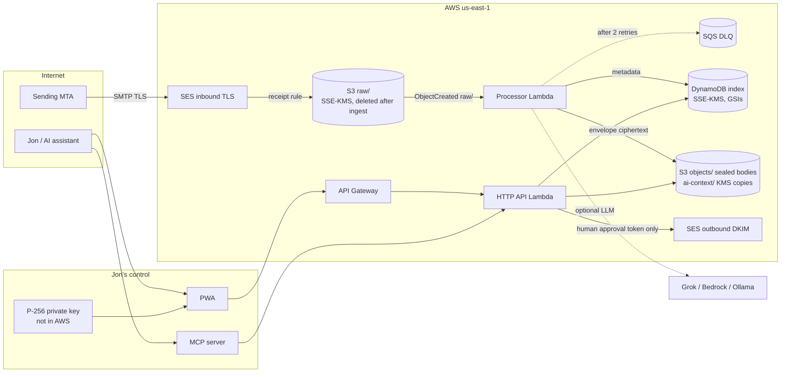

# lojo-mail architecture

lojo-mail is Jon Hebert's personal mailbox for `lojo@cyberphysical.us`. The domain is a config value (`domain` + `local_part`), so the same system can later be pointed at `lojo.dev` or another domain by creating a new SES identity and DNS plan. Nothing here is multi-tenant.

AWS is the only cloud in the mail path. Google Cloud (project `montano-349204`, Cloud Run) is intentionally unused: one account, one bill, and no always-on server. GCE is a poor fit anyway because it blocks outbound port 25, and Amazon WorkMail is discontinued.

## Why Terraform

Infrastructure is Terraform (AWS provider 5.x), not CDK.

- `terraform plan` is a readable diff Jon can review before anything is created. CDK would hide that behind a synthesized template and a bootstrap stack (ECR, IAM roles, an S3 bucket) that costs money and is easy to forget.
- DNS is data. The plan emits the exact Route 53 records and refuses to write them unless a cutover confirmation string is set.
- This repo is standalone. CDK pays off when the rest of the account is already CDK.

`terraform validate` does not need AWS credentials. `terraform plan` does, and it is still only a plan. This repo never applies.

## Mail flow

1. The apex MX already points at `inbound-smtp.us-east-1.amazonaws.com`. Standing up lojo-mail does not change it. The region stays a Terraform variable so a later domain can use another receiving region.
2. An SES receipt rule requires TLS, scans for spam/virus, and writes the raw MIME object into S3 under `raw/`. The S3 action names no KMS key; the bucket's default SSE-KMS (customer-managed key, bucket key on) encrypts it at rest, so the processor reads it with a plain `GetObject`. The rule names `lojo@<domain>` and `dmarc@<domain>` only. Other SES identities in the account stay untouched.
3. An S3 event invokes the processor Lambda. The function parses MIME, reads the SES verdict headers, seals the body and each attachment to Jon's public key into `objects/`, writes metadata to DynamoDB, runs the AI pipeline, and deletes the `raw/` object. AI failure never fails receipt. Any other failure throws; S3's async invoke retries twice, then the event lands in an SQS dead-letter queue with its `raw/` key, and a CloudWatch alarm fires. `docs/RUNBOOK.md` has the redrive.
4. The HTTP API and the MCP server read that index. Bodies stay sealed until something that holds Jon's private key opens them, which in production is only the browser.
5. Outbound mail is built by the API and sent with SESv2 only with a one-time approval token that a human web session minted for that exact content. The AI pipeline has no sender dependency, and the MCP server has no send tool.

## Components

| Piece | Where | Role |
| --- | --- | --- |
| Terraform | `infra/terraform` | SES, KMS, S3, DynamoDB, IAM, Lambda, API Gateway, DNS *plan* |
| `@lojo/core` | `packages/core` | Types, MIME, envelope crypto, store interface, AI pipeline, OpenPGP helpers |
| `@lojo/pipeline` | `packages/pipeline` | S3 Lambda handler, plus the AWS adapters (DynamoDB document store, S3 blob store, KMS key wrapper) |
| `@lojo/api` | `packages/api` | Hono HTTP API. Lambda or `npm run dev` |
| `@lojo/mcp` | `packages/mcp` | MCP tools over the same service layer, with scopes |
| `@lojo/web` | `packages/web` | Vite + React PWA |
| `@lojo/importer` | `packages/importer` | Idempotent `.eml` / mbox / vCard / CSV import, into a local store or into AWS |

Local development uses an in-memory DynamoDB (`MemoryDynamo`) behind the same store class the Lambdas use, so key schemas, conditional writes, index queries, and the 400 KB item limit behave like DynamoDB. Blobs go to memory or to a directory, and the KMS wrapper is a local AES key. No AWS calls. Both Lambdas are ESM bundles on `nodejs22.x`; `npm run bundles:check` imports each built bundle.

## Storage model

DynamoDB (on-demand, SSE-KMS, point-in-time recovery, deletion protection) holds the index. Every read is a `GetItem` or a paginated `Query`; nothing scans, and nothing deletes items.

| Table | Key | Indexes |
| --- | --- | --- |
| messages | `id` (`msg_` + SHA-256 of the delivery id) | `folder` (folder, date), `thread` (threadId, date), `rfc` (rfcMessageId, date) |
| threads | `id` | `recent` (kind, lastDate); an emptied thread drops `kind` and leaves the listing |
| drafts | `id` | `recent` (kind, updatedAt) |
| contacts | `email` | `all` (kind, email) |
| audit | `day`, `id` | none |
| budget | `day` | none; the counter is an atomic `ADD` |

S3 holds:

- `raw/{sesKey}` — original MIME written by SES. Deleted by the processor after ingest; lifecycle expires leftovers after `raw_retention_days` (7) and noncurrent versions after 1 day.
- `objects/{id}.bin` — the envelope of the body (text, HTML, and the sensitive half of the AI annotation).
- `objects/{id}/{attachmentId}.bin` — one envelope per attachment. DynamoDB keeps only the keys, so items stay small whatever the attachment size.
- `ai-context/{id}.bin` — a KMS-sealed, truncated text copy of recent inbound mail for server-side AI. Expires after `ai_context_days` (30); `0` turns it off.

The index is queryable without Jon's key. That is a deliberate usability tradeoff, not an accident. These fields are stored in the clear inside DynamoDB (still encrypted at rest by KMS):

- from, to, cc, subject, date, folder, labels, unread, bulk flag
- category, priority, phishing score
- attachment file names and sizes
- a short snippet

These fields are inside the envelope and are unreadable without Jon's private key:

- text body, HTML, attachment bytes
- AI summary, thread summary, action items, suggested reply

See [SECURITY.md](SECURITY.md) for what that does and does not protect.

## Encryption layers

1. **TLS on the wire.** Inbound receipt rule sets `tls_policy = Require`. Outbound uses an SESv2 configuration set with `tls_policy = REQUIRE`. MTA-STS and TLS-RPT records are in the DNS plan.
2. **KMS at rest.** One customer-managed key encrypts the bucket (with a bucket key, to keep request cost down) and the DynamoDB tables. SES may use it only for data keys, only from this account, and only for this receipt rule set (`aws:SourceArn`).
3. **Per-message envelope.** `P-256 ECDH + HKDF-SHA256 + AES-256-GCM`, with the message id (and attachment id) as additional authenticated data. The processor seals to Jon's public key. The private key is never written to AWS, to the repo, or to disk by the server. The web app fetches `GET /v1/messages/:id/body` and opens it in the tab.
4. **KMS data keys for server-readable data.** Drafts and the AI-context copy are sealed with per-item KMS data keys under an encryption context (`purpose` plus the id). IAM conditions on that context decide which role can create or open each kind. See SECURITY.md, key custody.
5. **OpenPGP, optional.** WKD publishing, detection of inbound encrypted mail (stored armored, not stripped), and outbound encryption to every recipient plus Jon's own key, signed when a signing key is configured. This is the only path that is end-to-end against SES.

## AI

Every non-bulk inbound message, within the daily token budget, is sent to a provider behind one interface:

- `grok` — OpenAI-compatible `POST /v1/chat/completions` (default base `https://api.x.ai/v1`)
- `bedrock` — Amazon Bedrock Runtime `Converse`
- `ollama` — Jon's lab machine at `http://100.96.1.90:11434` (`llama3.2:1b`, embeddings via `nomic-embed-text`)
- `mock` — tests and offline demo

The pipeline asks for one JSON object: summary, category, priority, action items and deadlines, labels, phishing score, unsubscribe info, thread summary, and a draft reply conditioned on `config/style-guide.md`. Heuristic phishing signals are merged with the model score. Embeddings are stored for semantic search when the provider can embed.

Cost guards: daily token budget in DynamoDB, body truncation, skip mail that looks like a list (`List-Id` + `List-Unsubscribe`, or `Precedence: bulk|list|junk`). Every model call, skip, and failure is an audit event. Prompts are not stored; the audit row keeps a SHA-256 of the prompt, the token counts, and the message id.

The model cannot send. The ingest path does not receive a `MailSender`. Drafts land as `suggested`. Sending needs the `send` scope *and* an approval token that only a signed-in human session can mint; see SECURITY.md, human approval. Priority and labels from the model are advisory: phishing-scored mail is demoted out of triage and labels pass an allowlist.

In production the API has no envelope private key. Draft reply and summarize use the AI-context copy when it exists, or text the browser opened locally and sent as `sourceText`.

## Interfaces

- **HTTP API** under `/v1`. Two kinds of principal: API tokens with scopes `read`, `write`, `send`, `body`, `admin`, and human sessions from `POST /v1/session/login` (passphrase). Each route declares its scope or requires a human. API Gateway throttles the stage.
- **MCP server** (`@lojo/mcp`) over the HTTP API with an API token. Each tool declares a scope. There is no send tool; agents call `submit_for_approval`, and every tool result is wrapped as untrusted content.
- **PWA** (`@lojo/web`): passphrase sign-in, inbox, triage, thread with AI summary and attachment download, compose with draft, rewrite, and one-click approve-and-send, a Drafts view with the approval queue, search, labels, settings. The API URL comes from `VITE_LOJO_API_URL` at build time, with an override in Settings. Phone layout stacks the list and the reader.
- **Outbound** via SESv2 `SendEmail` (and raw MIME when OpenPGP armor must be preserved). DKIM is Easy DKIM on the domain identity. Custom MAIL FROM is `mail.<domain>`.

## IMAP / JMAP (later, not in v1)

Apple Mail and Thunderbird need a standard access protocol. The store is already shaped like JMAP (`Mailbox`, `Email`, `Thread`, `EmailSubmission`):

- Preferred later step: a JMAP facade (RFC 8620 / 8621) in front of `MailStore`, authenticated with the same scoped tokens, bound to the tailnet rather than the public internet.
- IMAP is the compatibility fallback (Apple Mail still wants it). A small IMAP facade would map folders to `folder` and speak IDLE for push. It should not run on a public port 143.
- Neither facade is required for the web app, the API, or MCP, so they are not in the first release.

## What the September 2026 audit already found

A read-only look at the account, not an apply:

- SES for `cyberphysical.us` is verified in **us-east-1**, along with identities `cyberdevsec.com` and `jon@lojo.engineering`. This stack adopts `var.domain` and does not edit the other two.
- Easy DKIM is already published (six CNAMEs). Custom MAIL FROM is `mail.cyberphysical.us` (MX `feedback-smtp.us-east-1.amazonses.com` plus an SPF TXT). Apex SPF is `v=spf1 include:amazonses.com ~all`. DMARC is `v=DMARC1;p=quarantine;pct=100;fo=1` with no `rua`.
- The apex MX is already the us-east-1 inbound endpoint, TTL 1800. No receipt rule set is active in any region, so the new rule set is what starts delivery into the bucket.
- Leave these records alone: ACM validation CNAME, the six DKIM CNAMEs, `_amazonses`, the `mail.` MX and TXT, NS, and SOA. Do not add a second SPF TXT.
- `autodiscover` and `_amazonchime` look like WorkMail leftovers. They are optional cleanup after Jon confirms WorkMail is gone.
- Registrar is Gandi, managed through Route 53 Domains. DNSSEC is off. Enabling it is optional and needs a KMS signing key the current deploy user cannot create.
- IAM user `grok-rw` can use Route 53, Route 53 Domains, and SES. It cannot create KMS, S3, Lambda, DynamoDB, IAM, API Gateway, or SSM. Apply uses a different principal. This repo does not grant `grok-rw` anything.

`ses_identity_mode = existing` (the default) reads that identity and creates the receipt rule set, the bucket, the key, and the functions. `terraform output dns_plan` lists suggested additions and does not create them: a `rua` on the existing DMARC record (to `dmarc@<domain>`, not a second TXT), TLS-RPT, MTA-STS once the policy host exists, OpenPGP WKD hosting, and a lower MX TTL only before a future region move. `manage_dns = true` is refused in existing mode so a plan cannot overwrite those records.

## Domain switch

`domain` and `local_part` are variables. Moving from `cyberphysical.us` to `lojo.dev` means `ses_identity_mode = create` for that new name, a second DNS plan, and a decision about what happens to the old MX (leave it accepting into the same bucket, or drop it). The processor keys off the recipient only to file the message; it does not hard-code the domain in storage.

## What is intentionally not here

- No always-on EC2, ECS, or Cloud Run service.
- No WorkMail, no Google Workspace, no outbound port 25.
- No CloudFront distribution by default. The PWA is a static build Jon can host on an existing HTTPS origin or open locally. Serving the unlock UI over plain HTTP in production would expose the private key.
- No live DNS changes, no terraform apply, no purchased certificates or domains.
