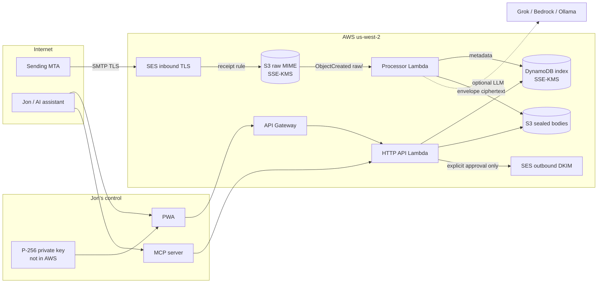

# lojo-mail architecture

lojo-mail is Jon Hebert's personal mailbox for `lojo@cyberphysical.us`. The domain is a config value (`domain` + `local_part`), so the same system can later be pointed at `lojo.dev` or another domain by creating a new SES identity and DNS plan. Nothing here is multi-tenant.

AWS is the only cloud in the mail path. Google Cloud (project `montano-349204`, Cloud Run) is intentionally unused: one account, one bill, and no always-on server. GCE is a poor fit anyway because it blocks outbound port 25, and Amazon WorkMail is discontinued.

## Why Terraform

Infrastructure is Terraform (AWS provider 5.x), not CDK.

- `terraform plan` is a readable diff Jon can review before anything is created. CDK would hide that behind a synthesized template and a bootstrap stack (ECR, IAM roles, an S3 bucket) that costs money and is easy to forget.
- DNS is data. The plan emits the exact Route 53 records and refuses to write them unless a cutover confirmation string is set.
- This repo is standalone. CDK pays off when the rest of the account is already CDK.

`terraform validate` does not need AWS credentials. `terraform plan` does, and it is still only a plan. This repo never applies.

## Mail flow

1. MX for the domain points at `inbound-smtp.us-west-2.amazonaws.com` (only after the DNS audit).
2. An SES receipt rule requires TLS, scans for spam/virus, and writes the raw MIME object into S3 under `raw/`, encrypted with a customer-managed KMS key.
3. An S3 event invokes the processor Lambda. The function parses MIME, seals the body to Jon's public key, writes metadata to DynamoDB, and runs the AI pipeline. AI failure never fails receipt.
4. The HTTP API and the MCP server read that index. Bodies stay sealed until something that holds Jon's private key opens them.
5. Outbound mail is built by the API and sent with SESv2 only after an explicit approve-and-send call. The AI pipeline has no sender dependency.

## Components

| Piece | Where | Role |
| --- | --- | --- |
| Terraform | `infra/terraform` | SES, KMS, S3, DynamoDB, IAM, Lambda, API Gateway, DNS *plan* |
| `@lojo/core` | `packages/core` | Types, MIME, envelope crypto, store interface, AI pipeline, OpenPGP helpers |
| `@lojo/pipeline` | `packages/pipeline` | Pure `processInbound` plus the S3 Lambda handler |
| `@lojo/api` | `packages/api` | Hono HTTP API. Lambda or `npm run dev` |
| `@lojo/mcp` | `packages/mcp` | MCP tools over the same service layer, with scopes |
| `@lojo/web` | `packages/web` | Vite + React PWA |
| `@lojo/importer` | `packages/importer` | Idempotent `.eml` / mbox / vCard / CSV import |

Local development uses the in-memory store and an in-memory object store. No AWS calls. A DynamoDB adapter exists for the deployed API; point `AWS_ENDPOINT_URL` at LocalStack if you want to exercise it.

## Storage model

DynamoDB (on-demand, SSE-KMS) holds the index:

- messages, threads, drafts, approvals, contacts, import ledger, daily token budget, audit events

S3 holds:

- `raw/{id}` — original MIME, SSE-KMS, written by SES
- `objects/{id}.bin` — application-layer envelope of the body, attachment bytes, and the sensitive half of the AI annotation

The index is queryable without Jon's key. That is a deliberate usability tradeoff, not an accident. These fields are stored in the clear inside DynamoDB (still encrypted at rest by KMS):

- from, to, cc, subject, date, folder, labels, unread, bulk flag
- category, priority, phishing score
- attachment file names and sizes
- a short snippet

These fields are inside the envelope and are unreadable without Jon's private key:

- text body, HTML, attachment bytes
- AI summary, thread summary, action items, suggested reply

See [SECURITY.md](SECURITY.md) for what that does and does not protect.

## Encryption layers

1. **TLS on the wire.** Inbound receipt rule sets `tls_policy = Require`. Outbound uses an SESv2 configuration set with `tls_policy = REQUIRE`. MTA-STS and TLS-RPT records are in the DNS plan.
2. **KMS at rest.** One customer-managed key encrypts the bucket (with a bucket key, to keep request cost down) and the DynamoDB tables. SES is granted `GenerateDataKey` only from this account.
3. **Per-message envelope.** `P-256 ECDH + HKDF-SHA256 + AES-256-GCM`. The processor seals to Jon's public key. The private key is never written to AWS, to the repo, or to disk by the server. The web app holds it in memory after unlock.
4. **OpenPGP, optional.** WKD publishing, detection of inbound encrypted mail (stored armored, not stripped), and outbound encrypt-and-sign when a recipient key and a signing key are both present. This is the only path that is end-to-end against SES.

## AI

Every non-bulk inbound message, within the daily token budget, is sent to a provider behind one interface:

- `grok` — OpenAI-compatible `POST /v1/chat/completions` (default base `https://api.x.ai/v1`)
- `bedrock` — Amazon Bedrock Runtime `Converse`
- `ollama` — Jon's lab machine at `http://100.96.1.90:11434` (`llama3.2:1b`, embeddings via `nomic-embed-text`)
- `mock` — tests and offline demo

The pipeline asks for one JSON object: summary, category, priority, action items and deadlines, labels, phishing score, unsubscribe info, thread summary, and a draft reply conditioned on `config/style-guide.md`. Heuristic phishing signals are merged with the model score. Embeddings are stored for semantic search when the provider can embed.

Cost guards: daily token budget in DynamoDB, body truncation, skip mail that looks like a list (`List-Id` + `List-Unsubscribe`, or `Precedence: bulk|list|junk`). Every model call, skip, and failure is an audit event. Prompts are not stored; the audit row keeps a SHA-256 of the prompt, the token counts, and the message id.

The model cannot send. `AiPipeline` does not receive a `MailSender`. Drafts land as `suggested`. `approve_and_send` requires the `send` scope and a human (or a human-driven tool call) hitting that endpoint.

## Interfaces

- **HTTP API** under `/v1`, bearer tokens, scopes `read`, `write`, `send`, `admin`.
- **MCP server** (`@lojo/mcp`) exposing the tools in the project brief. Each tool declares a scope. A read-only token cannot approve or send.
- **PWA** (`@lojo/web`): inbox, triage, thread with AI summary, compose with draft and rewrite, search, labels, settings. Phone layout stacks the list and the reader.
- **Outbound** via SESv2 `SendEmail` (and raw MIME when OpenPGP armor must be preserved). DKIM is Easy DKIM on the domain identity. Custom MAIL FROM is `mail.<domain>`.

## IMAP / JMAP (later, not in v1)

Apple Mail and Thunderbird need a standard access protocol. The store is already shaped like JMAP (`Mailbox`, `Email`, `Thread`, `EmailSubmission`):

- Preferred later step: a JMAP facade (RFC 8620 / 8621) in front of `MailStore`, authenticated with the same scoped tokens, bound to the tailnet rather than the public internet.
- IMAP is the compatibility fallback (Apple Mail still wants it). A small IMAP facade would map folders to `folder` and speak IDLE for push. It should not run on a public port 143.
- Neither facade is required for the web app, the API, or MCP, so they are not in the first release.

## Domain switch

`domain` and `local_part` are variables. Moving from `cyberphysical.us` to `lojo.dev` means a second SES identity, a second DNS plan, and a decision about what happens to the old MX (leave it accepting and forwarding into the same bucket, or drop it). The processor keys off the recipient only to file the message; it does not hard-code the domain in storage.

## What is intentionally not here

- No always-on EC2, ECS, or Cloud Run service.
- No WorkMail, no Google Workspace, no outbound port 25.
- No CloudFront distribution by default. The PWA is a static build Jon can host on an existing HTTPS origin or open locally. Serving the unlock UI over plain HTTP in production would expose the private key.
- No live DNS changes, no terraform apply, no purchased certificates or domains.
