# LOJO Mail for iPhone

A native SwiftUI client for **lojo@cyberphysical.us**. It talks to the same HTTP API as the web app
(`https://zp7h9ytl28.execute-api.us-east-1.amazonaws.com`, the web app is https://app.cyberphysical.us), signs in with
the web passphrase, and opens every sealed body and attachment **on the phone** with the envelope private key, which
lives in the iOS Keychain. Nothing it writes is sent until Jon taps **Approve and send** and confirms.

Built on Santa Computa (Linux) with [xtool](https://github.com/xtool-org/xtool), Swift 6.3.3 and the Xcode 26 SDK,
signed with a free Apple ID and installed over USB, the same way as
[LOJO Networks](https://github.com/macdadyj/lojo-private-networks-ios). No Mac, no paid developer account.

| | |
| --- | --- |
| [docs/ARCHITECTURE.md](docs/ARCHITECTURE.md) | Targets, data flow, API contract the app relies on |
| [docs/SECURITY.md](docs/SECURITY.md) | Where the key, session and mail live on the phone; send guards; what a free account can't do |
| [docs/TESTING.md](docs/TESTING.md) | Core tests, live tests, QA launch hooks, and what is still untested |

## What it does

- **Mail**: Inbox, Sent, Drafts, Trash, Junk and Archive; conversations grouped by thread; pull to refresh; search
  (filters the loaded list as you type, searches the server on Return); swipe to mark read, star, archive, trash
  (soft delete, restorable for the retention period) and restore; Move to any folder from the context menu.
- **Reading**: bodies decrypted on the phone ("Sealed to your key"), links detected, AI summary and phishing warning,
  sender verdicts, attachments decrypted and opened in Quick Look (temporary file, deleted when closed).
- **Writing**: compose, reply, reply all, forward, and "AI reply". Save a draft, put it in the approval queue, ask the
  AI to rewrite it, or **Approve and send** behind a confirmation that names the recipients and the From address. The
  approval is bound to the exact reviewed content; if a bot changed the draft meanwhile, the app shows what changed and
  makes you look before it will send.
- **Review**: drafts waiting for approval, drafts written by the AI, bots or Thunderbird, and your own drafts; open one
  to edit and send, swipe to discard.
- **AI Rules**: status of the rules engine and every rule; a big **Stop all autonomous sending** button (the rules
  kill switch, engages instantly), a **Stop all sending** switch (the global send kill switch from PR #7, which also
  stops approved sends and Thunderbird), pause/resume, and swipe to disable a rule. Releasing or resuming asks first,
  and the server only lets a signed-in human session do it.
- **Freshness**: a 60-second poll while open, iOS background app refresh, and local notifications for new mail
  (sender, optionally subject). **There is no push (APNs): a free Apple account can't use it**, so notifications arrive
  whenever iOS decides to run background refresh, which can be hours apart.
- **Settings**: session expiry, key fingerprint / replace / remove (with import instructions), send test mode, notifications, Face ID lock,
  server URL, sign out.
- Dark mode, Dynamic Type, VoiceOver labels, empty / error / offline / missing-key states throughout.

## Build and install

Prerequisites are the toolchain in `~/.config/ios-dev/env` (xtool, Swift 6.3.3, Darwin SDK, pymobiledevice3) and a
trusted, USB-attached iPhone. Build on ext4 only; `sync-app.sh` refuses anything else.

```bash
ios/scripts/deploy-phone.sh --build     # compile only
ios/scripts/deploy-phone.sh             # build, sign with the free Apple ID, install over USB, launch
ios/scripts/provision-phone.sh          # hand the app a fresh session + the envelope key over USB (optional)
```

The phone's UDID is read from USB at run time (or `LOJO_UDID`); it is never written to the repo. The installed bundle
ID is `XTL-HG9HAYXW44.com.lojo.Mail` (xtool prefixes the team ID).

### Signing in on the phone

Type (or autofill) the web passphrase. The eye button shows what you typed; it hides again when the app leaves the
screen. The form has an **Account** field (prefilled with the mailbox) next to the passphrase so password managers
treat it as a login: tap the passphrase field and pick the credential from the key / **Passwords** button above the
keyboard (iCloud Keychain, 1Password and others). Save the passphrase in your password manager under
`lojo@cyberphysical.us` with website `app.cyberphysical.us` so it is easy to find.

What a free account can't do here: iOS only offers the credential *automatically* and asks "Save password?" when the
app has an Associated Domains entitlement (`webcredentials:app.cyberphysical.us`) plus an
`apple-app-site-association` file on that site. Free personal teams can't get that entitlement, so on the phone you
pick the credential from the Passwords list yourself, and new passphrases are saved in the password manager, not
from the app.

### Loading the envelope key

After sign-in the app asks for `envelope.private.jwk` (later: **Settings → Decryption → Replace key…**). Any of:

- **Files**: *Choose from Files…* and pick the file (iCloud Drive, On My iPhone, a USB stick, any Files provider).
- **AirDrop**: AirDrop the file from the Mac and choose LOJO Mail.
- **Share sheet / Open in**: in Files, Mail or any app, share the file and pick LOJO Mail.
- **Paste**: copy the JWK text and tap *Paste*; the clipboard is cleared once the key is saved.
- **By hand**: type or paste into the hidden field (eye to check), then *Save to Keychain*.
- **USB from Santa Computa**: `ios/scripts/provision-phone.sh` signs in on the host and pushes the session and the key
  into the app's private container; the app moves both into the Keychain and deletes the files on its next launch.

AirDrop, share and "Open in" copy the file into the app's Documents/Inbox. The app reads it, deletes that copy at once,
shows the key's fingerprint (and whether it matches the mailbox's published fingerprint) and asks before storing or
replacing the key. A key for a different mailbox, the public key, or the web app's wrapped key (`lojo-key-v1.…`) is
refused with a message saying which file to use. The app registers `.jwk` and `.json` as an *alternate* handler, so it
never becomes the default app for JSON.

Free-account limits to know:

- The provisioning profile lasts **7 days**. Re-run `deploy-phone.sh` before it lapses; the Keychain survives reinstall.
- **At most 3 sideloaded apps.** HelloLab was uninstalled to make room (rebuild it from
  `~/.local/share/ios-dev/apps/HelloLab` if you want it back). Currently installed: LOJO Mail, LOJO Private Networks,
  RanchField.

## Tests

```bash
ios/scripts/test-core.sh               # offline: envelope crypto against the repo's TypeScript sealer, models, helpers
ios/scripts/test-core.sh --live        # + read-only checks against the deployed API with Jon's session and key
ios/scripts/test-core.sh --live-write  # + mail actions, kill switches, and one real send to lojo-test@cyberphysical.us
```

## Screenshots (iPhone 11, iOS 26.6.2, dark mode)

| | | |
| --- | --- | --- |
| 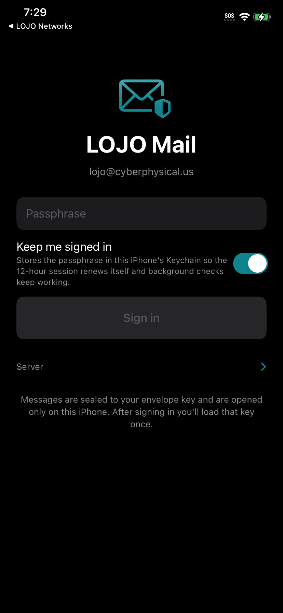 Sign in | 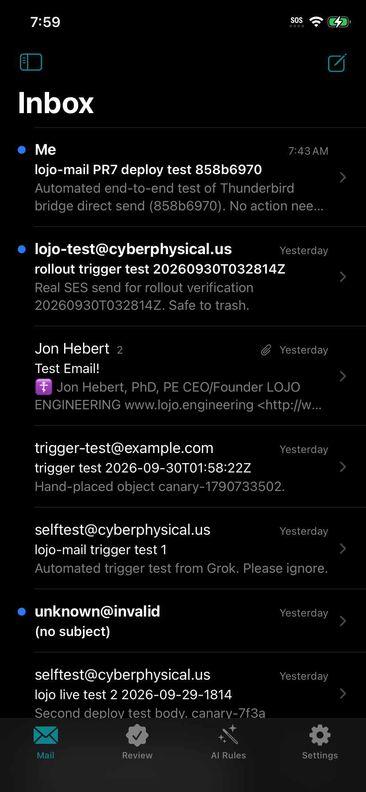 Inbox | 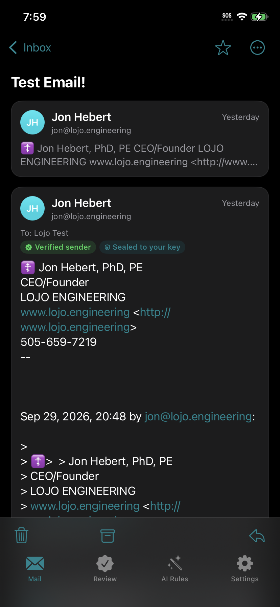 Thread, body decrypted on the phone |
|  Attachment decrypted, Quick Look | 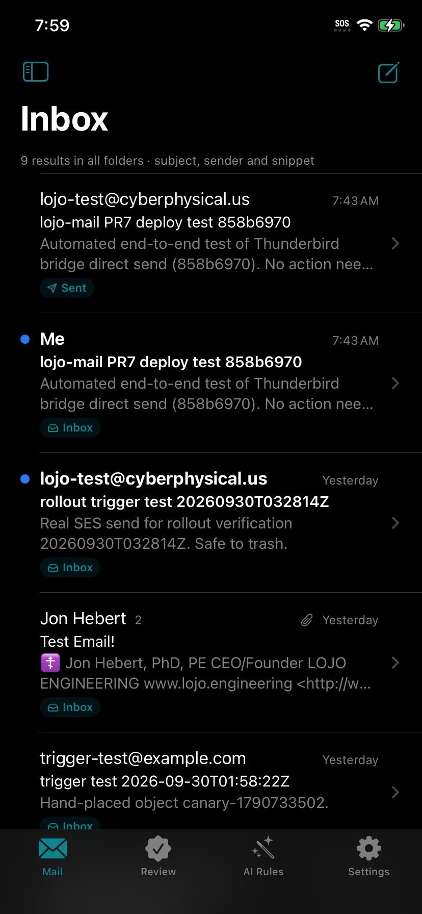 Server search | 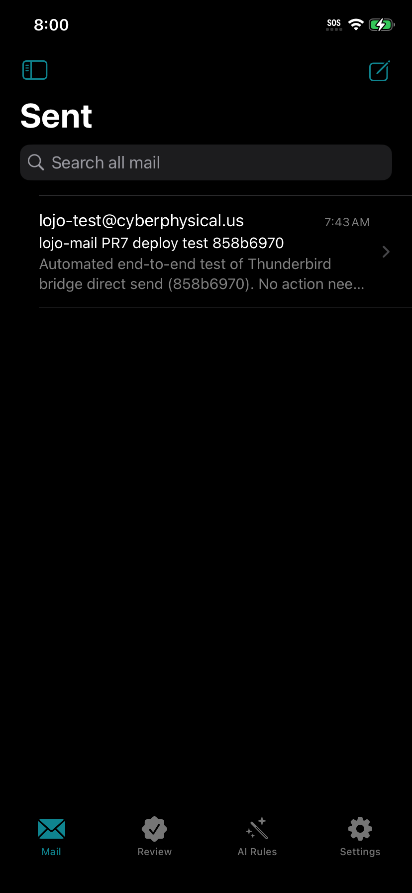 Sent folder |
| 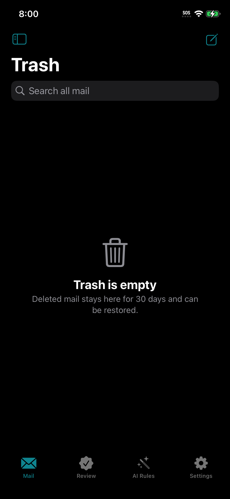 Trash | 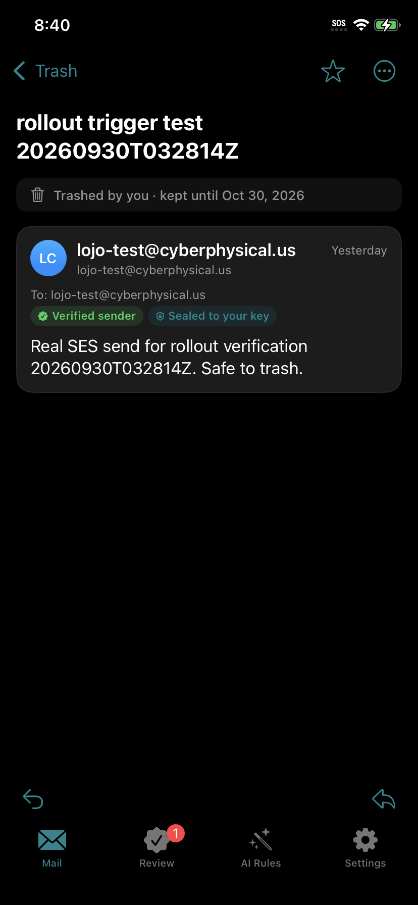 Trashed by you, kept 30 days | 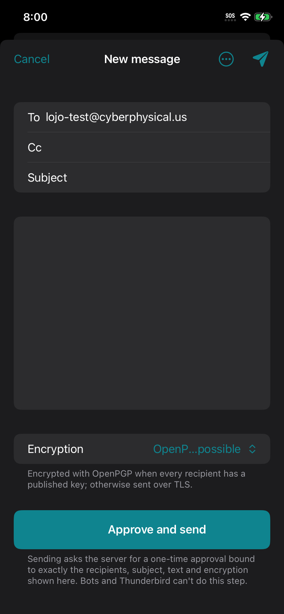 Compose |
| 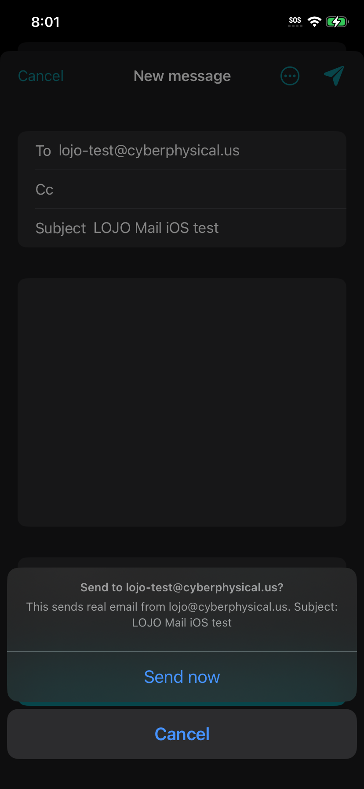 Send confirmation | 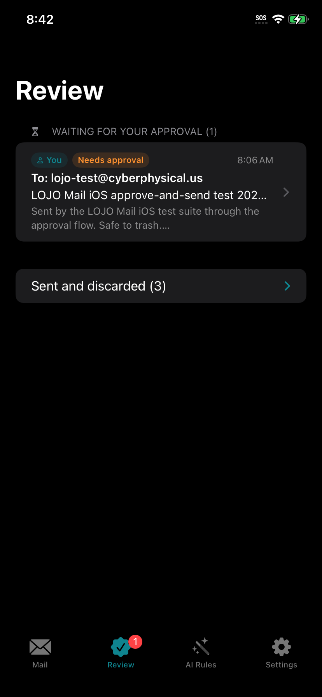 Review queue | 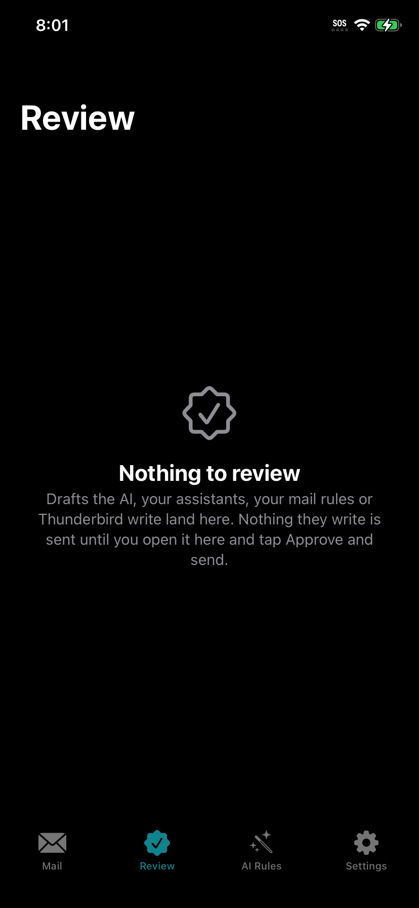 Draft waiting for approval |
| 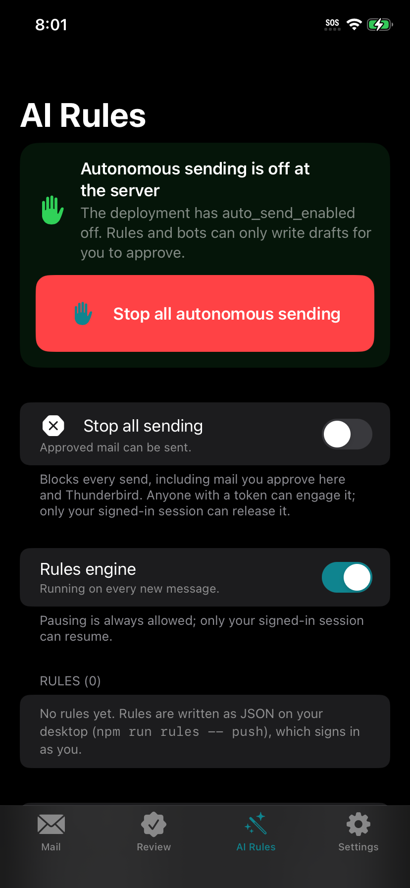 AI Rules and kill switches | 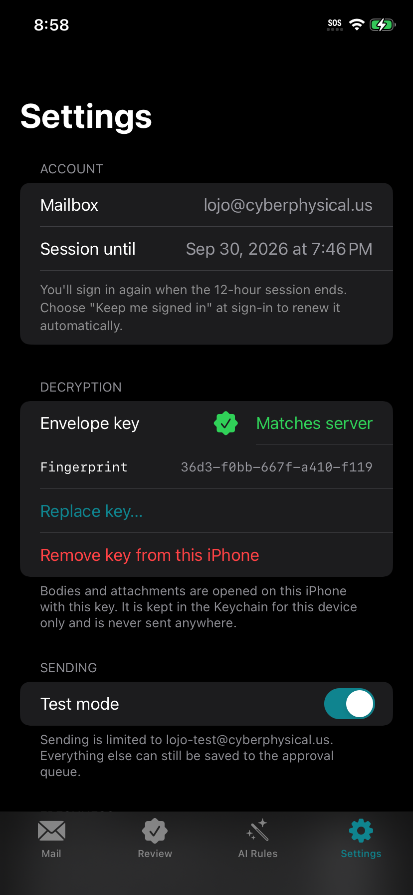 Settings | 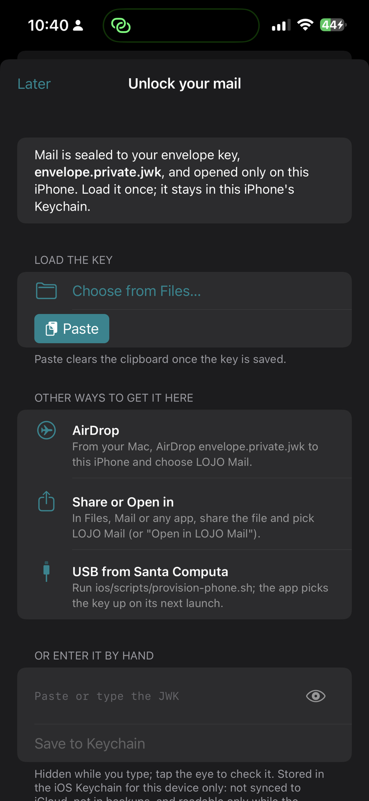 Envelope key setup |

The screenshots show real (test) mail from the mailbox. The repo is private; crop or regenerate them before making it public.
